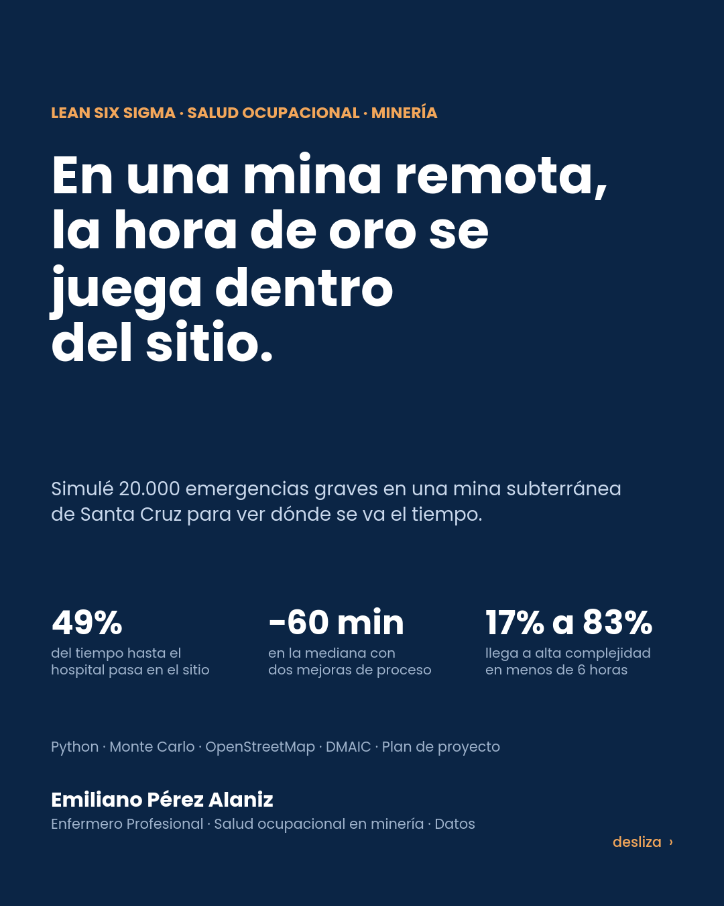
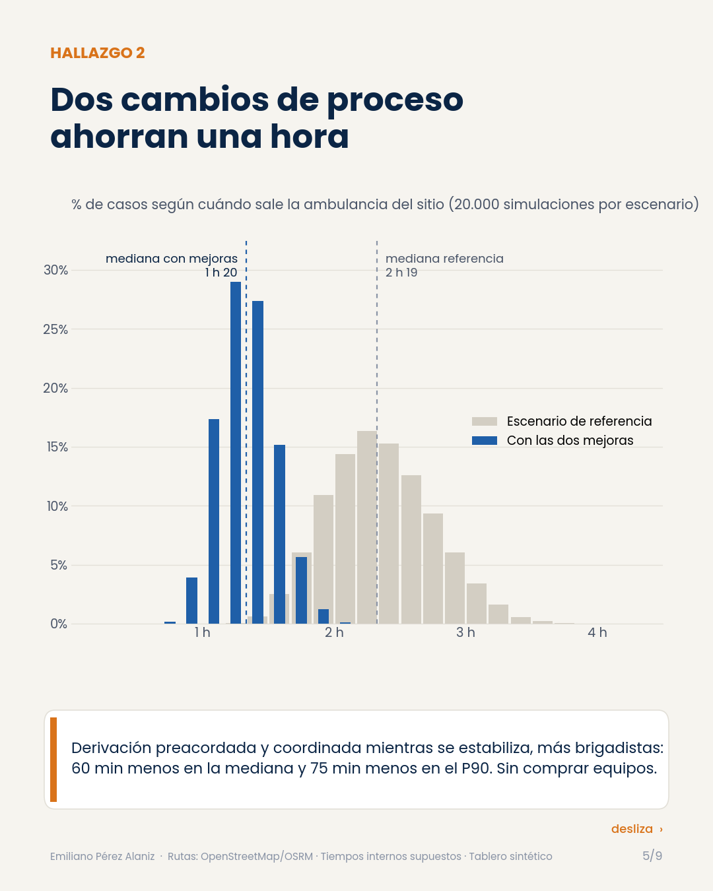

# Respuesta médica en una mina remota

**Simulador Monte Carlo, tablero del servicio médico y plan de 100 días para liderar un servicio médico en una mina subterránea de Santa Cruz (Argentina)**

Autor: Emiliano Pérez Alaniz · Enfermero Profesional · Salud ocupacional en minería · Lean Six Sigma y análisis de datos



## La pregunta

En una mina remota el hospital más cercano queda a dos o tres horas por ruta, y eso no se puede cambiar. ¿Cuánto del tiempo hasta el hospital pasa dentro del sitio, entre el aviso y la salida de la ambulancia, y qué cambios de proceso lo acortan?

## Qué encontré

| Indicador (mediana salvo que diga P90) | Referencia | Con las dos mejoras |
|---|---|---|
| Primer contacto con el paciente | 23 min | 12 min |
| Soporte vital avanzado (llega el equipo médico) | 23 min | 23 min |
| Sale la ambulancia del sitio | 2 h 19 | 1 h 20 |
| Sale la ambulancia del sitio, P90 | 2 h 53 | 1 h 37 |
| Llega al hospital más cercano (Las Heras) | 4 h 46 | 3 h 46 |
| Casos en hospital de alta complejidad en menos de 6 h | 17% | 83% |

1. **Casi la mitad del tiempo (49%) hasta el hospital más cercano pasa dentro del sitio.** Es la parte que se resuelve dentro del sitio.
2. **La espera más larga es coordinar la derivación:** 41 min de mediana. En el escenario de referencia arranca recién cuando termina la estabilización.
3. **Derivación preacordada y coordinada en paralelo:** criterios escritos y un contacto único por hospital. Sola, esta mejora adelanta la salida 55 min en la mediana y 64 min en el P90. Sumada a los brigadistas, 60 y 75 min. Sin comprar equipos.
4. **Brigadistas bajo mina:** en los eventos bajo mina el primer contacto llega en minutos y la mediana general baja de 23 a 12 min. El soporte vital avanzado sigue dependiendo de cuánto tarda el equipo médico en llegar.
5. **En invierno** (35% de chance de demoras en ruta) el P90 de llegada al hospital sube de 5 h 40 a 6 h 20 sin mejoras.

## Qué es real, qué es supuesto y qué es sintético

| Pieza | Origen |
|---|---|
| Ubicación de la mina | Pública: artículo "Cerro Negro mine" de Wikipedia |
| Hospitales de derivación | OpenStreetMap (Nominatim): Perito Moreno, Las Heras, Caleta Olivia y Comodoro Rivadavia |
| Distancias y tiempos de ruta | OSRM sobre OpenStreetMap, consulta del 23/10/2026, ajustados entre 65% y 100% para cubrir la referencia de unas dos horas hasta la localidad más cercana |
| Tiempos de cada tramo dentro del sitio | **Supuestos**, documentados en `modelo/supuestos.csv` |
| Indicadores del servicio médico (52 semanas) | **Sintéticos**, generados con semilla fija en `tablero/generar_datos.py` |

No hay datos de ninguna empresa. El escenario de referencia es hipotético y no describe el desempeño actual de ninguna operación. La idea es mostrar el método: con registros reales de simulacros y eventos, el modelo se recalibra en una semana.

## Las tres piezas

**1. Simulador de la hora de oro** (`modelo/hora_de_oro.py`). Cada caso sortea seis tramos con distribuciones triangulares (aviso, llegada del equipo, extracción a superficie, estabilización, coordinación de la derivación y preparación de salida), más la ruta, el clima y una opción de avión sanitario desde Perito Moreno. 20.000 casos por escenario y seis escenarios.

**2. Tablero del servicio médico** (`tablero/`). Los indicadores que pide un puesto de Team Lead: evaluaciones de salud al día, brigadistas con certificación vigente, tiempo de llegada del equipo, stock crítico con mínimos y máximos, consultas por motivo y una carta U de consultas por 1.000 personas-día. La carta detecta en la misma semana un brote digestivo simulado y separa el invierno respiratorio.

**3. Plan de 100 días** (`plan/`). Acta del proyecto, cronograma con Gantt, matriz RACI, registro de riesgos, árbol de indicadores y dos proyectos DMAIC (salida del sitio y quiebres de stock). En PDF para imprimir y en Excel con fórmulas.

La página `docs/index.html` junta todo: simulador interactivo que corre el mismo modelo en el navegador, mapa con las rutas reales, tablero y fases del plan. Se abre directo en el navegador.



## Estructura

```
data/centros_derivacion.csv        hospitales de derivación (OpenStreetMap)
data/rutas_osrm.csv                km y minutos de ruta desde la mina (OSRM)
data/geografia.json                geometrías de rutas y límite de Santa Cruz para el mapa
modelo/supuestos.csv               rangos de cada tramo y probabilidades, con justificación
modelo/hora_de_oro.py              Monte Carlo y escenarios  ->  modelo/resultados.json
tablero/generar_datos.py           datos sintéticos e indicadores  ->  tablero/datos/*.csv, tablero/tablero.json
plan/contenido.py                  contenido del plan (fuente única)
plan/excel.py, plan/pdf.py         plan en Excel (con fórmulas) y en PDF
docs/construir_pagina.py           arma docs/index.html desde docs/plantilla.html
docs/carrusel.py                   carrusel de LinkedIn  ->  docs/img, docs/Carrusel_Servicio_Medico_Mina_Remota.pdf
```

## Cómo reproducir

```bash
pip install numpy pandas matplotlib openpyxl img2pdf playwright
python modelo/hora_de_oro.py
python tablero/generar_datos.py
python plan/contenido.py && python plan/excel.py && python plan/pdf.py
python docs/construir_pagina.py
python docs/carrusel.py
```

## Límites

- Los tiempos internos son supuestos razonables, no mediciones. El modelo vale por el método y por el orden de magnitud de cada tramo.
- OSRM usa velocidades de auto sobre OpenStreetMap; por eso el rango de ajuste.
- El nivel de cada hospital sale de su denominación oficial (distrital, zonal, regional). La capacidad real (terapia intensiva, tomógrafo, quirófano) hay que confirmarla con el sistema de salud provincial.
- El tablero usa datos sintéticos.
- "Alta complejidad en 6 h" toma para cada caso la opción más rápida entre ruta y avión, y no contempla que el avión no pueda volar por clima. Es un techo optimista.
- `plan/excel.py` escribe fórmulas sin valores calculados; Excel las calcula al abrir el archivo.

## Fuentes

- Wikipedia: [Cerro Negro mine](https://en.wikipedia.org/wiki/Cerro_Negro_mine) (ubicación).
- © colaboradores de [OpenStreetMap](https://www.openstreetmap.org/copyright) (ODbL), vía Nominatim y el servidor de demostración de [OSRM](https://project-osrm.org/).
